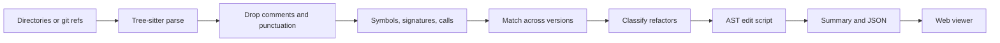
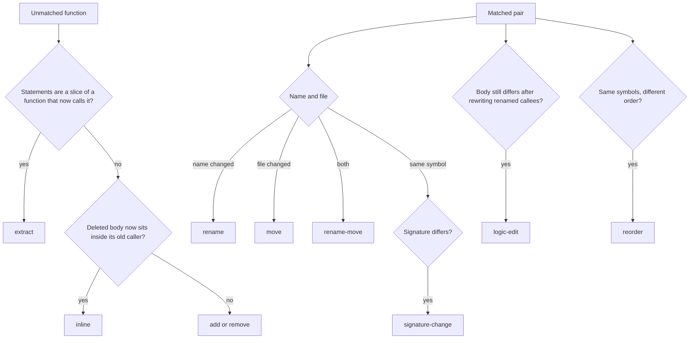

# semantic-diff

Semantic diffs for TypeScript and Python. Given two directories or two git refs, semantic-diff parses both trees, matches functions, methods, and classes, and reports the edit as refactoring operations instead of a wall of changed lines.

```text
renamed `foo` to `bar` (2 call sites and 1 import updated)
extracted `parseHeader` from `readFile`
```

Formatting-only edits (whitespace, comments, semicolons, trailing commas, and TypeScript quote style) are ignored. What remains of a real body change is a minimal AST diff: the `50` that became `75`, not a rewritten function.

## Quickstart

Requires Node.js 20 or newer. Tree-sitter grammars ship as native addons and install with npm.

```bash
npm install
npm test
npm run build
node dist/cli.js fixtures/typescript/mixed/before fixtures/typescript/mixed/after
node dist/cli.js view
```

During development, `npx tsx src/cli.ts` runs the CLI without a build step. The viewer is a static site; `semantic-diff view` serves it at `http://127.0.0.1:4173` with the bundled fixture reports.

Compare two git revisions from inside a repository:

```bash
node dist/cli.js git HEAD~1 HEAD -o report.json
node dist/cli.js view report.json
```

`--check` exits 1 when any semantic operation is present and 0 when the only edits are formatting. That makes the tool usable as a review gate:

```bash
node dist/cli.js --check fixtures/python/formatting/before fixtures/python/formatting/after
```

## Use it as a git difftool

Per-file and directory modes both work. Directory mode (`git difftool -d`) preserves paths, which is what move and extract detection want.

```bash
git config diff.tool semantic-diff
git config difftool.semantic-diff.cmd 'semantic-diff difftool "$LOCAL" "$REMOTE"'
git config difftool.prompt false
git difftool -d HEAD~1 HEAD
```

`difftool` receives the temp files or directories git already prepared. `git <ref1> <ref2>` instead archives each ref itself.

## What it reports

| Operation | Meaning |
| --- | --- |
| `rename` | Same body (or a near copy), new name. Call sites and imports are counted. |
| `move` | Same symbol, different file. Import specifiers that resolve from the old file to the new one are counted. |
| `rename-move` | Both of the above. |
| `extract` | A new function's statements are a contiguous slice of an older function, and that function now calls it. |
| `inline` | A deleted function's statements now sit inside a caller that used to call it. |
| `signature-change` | Parameters, types, defaults, async, decorators, or base classes changed. |
| `reorder` | The same symbols stayed in a file or class, in a different order. |
| `logic-edit` | A matched body still differs. The edit script is insert, delete, update, or move at the smallest subtree that explains it. |
| `add` / `remove` | A symbol with no match and no extract or inline explanation. |

Pure formatting never becomes one of these. A file whose normalized tree is unchanged is listed under `ignoredFormatting` and omitted from the operation list.

## Examples

Rename a function and a method, and update every call:

```bash
node dist/cli.js fixtures/typescript/rename/before fixtures/typescript/rename/after
```

```text
renamed `foo` to `bar` (3 call sites and 1 import updated)
renamed `Cart.cost` to `Cart.price` (1 call site updated)
```

Move a Python function and the import that points at it:

```bash
node dist/cli.js fixtures/python/move/before fixtures/python/move/after
```

```text
moved `slugify` from `text/slug.py` to `url/slug.py` (1 import updated)
```

A signature change that does not touch the body:

```text
signature of `connect` changed (added param `timeout`, return type `string` → `Promise<string>`)
```

A logic edit, with `--verbose` showing the leaves that actually changed:

```text
edited `shipping` (2 updates)

edited `shipping`
  update `50` → `75`
  update `2` → `3`
```

The same literal edits are reported when the after file also has new comments and blank lines. Those are not operations.

Machine-readable output is the same report:

```bash
node dist/cli.js --format json --no-sources \
  fixtures/typescript/mixed/before fixtures/typescript/mixed/after
```

The JSON schema is [`schema/report.schema.json`](schema/report.schema.json). `summary` is the one-line paragraph (`renamed …; extracted …`). `summaryLines` is that paragraph split for the viewer. `highlights` carries the spans the viewer paints. Pass `--no-sources` to drop embedded file text.

## Web viewer

`semantic-diff view [report.json]` serves the side-by-side viewer. Without a report it opens the fixture samples (rename, move, extract, inline, signature, reorder, logic, and formatting, in both languages). Choosing an operation scrolls both panes to the affected span and colors the lines by operation kind. `j` and `k` move through the list. Formatting-only files sit in their own section and render without a semantic highlight.

The viewer reads `sources` from the report, so generate JSON without `--no-sources` when you want to open it there.

## How it works



Parsing uses tree-sitter grammars for TypeScript, TSX, and Python. The normalized tree keeps named nodes and meaningful tokens (`+`, `await`, `and`) and drops comments, whitespace, semicolons, commas, and parentheses that do not change structure. Two files with the same normalized tree are formatting-only, even when the text differs.

Symbols are top-level functions, classes, methods, and arrow functions bound to a name. Each symbol stores a signature, the calls it makes, and statement skeletons. Local names and parameters are alpha-renamed inside each statement (`$0`, `$1`), so a refactor that also renames locals still matches, while `return a + a` and `return a + b` stay distinct.

Matching is three passes:

1. **Anchor** the same file, kind, and qualified name. A same-named symbol is not anchored when some other unmatched symbol has its exact body hash — that is a rename, and the old name was reused.
2. **Exact body hash** among what is left. Identical structure pairs renames and moves. Name and file break ties when several bodies match.
3. **High skeleton similarity** (Jaccard ≥ 0.86) so a rename that also edited the body can still pair.

Classification then follows the pairs:



Before a logic diff, renamed callees are rewritten on the before tree (`foo` → `bar`, `Cart.cost` → `Cart.price`). Call-site updates that are only the rename do not show up again as logic edits. Extract and inline regions are suppressed the same way: deleted statements that moved into the new function, and the call that replaced them, are not reported twice.

The edit script is an ordered tree diff. Identical subtrees anchor by hash, even out of order. Unmatched siblings with the same shape align so a changed literal stays a leaf update. Sibling order changes become the minimum set of moves — the nodes that fall outside the longest increasing subsequence of their new indexes — instead of a delete plus an insert for every shifted line.

## Library

```ts
import { analyzePaths } from "semantic-diff";

const report = analyzePaths("before/", "after/");
console.log(report.summary);
```

`analyzeSnapshots` accepts `{ label, files: [{ path, text }] }` when the inputs are not on disk. Paths in the report are relative and use forward slashes.

## Project layout

```text
src/            CLI, matching, tree diff, tree-sitter extraction
viewer/         side-by-side viewer and generated sample reports
fixtures/       before/after pairs for every operation, TypeScript and Python
schema/         JSON Schema for the report
test/           fixture suite, tree-diff unit tests, CLI tests
```

## Limitations

This is a syntactic analysis, not a typechecker. Call-site counts are uses of the name in call position (or the method name in a member call), not resolved bindings. Two different `cost` methods in one program can share a count.

Extract and inline detection requires a contiguous run of at least two statements. A trailing `return someLocal` added by an extract-method refactor is ignored when the statements above it match. Extracts that rewrite the slice into something other than those statements will not be classified as extracts.

Nested functions and lambdas are part of the enclosing body; they are not symbols of their own. Python docstrings are real statements, so editing one is a logic edit. `#` comments and TypeScript comments are formatting.

The matcher is built for a reviewable changeset — hundreds of symbols, not a multi-million-line corpus in one process.

## License

[MIT](LICENSE)
